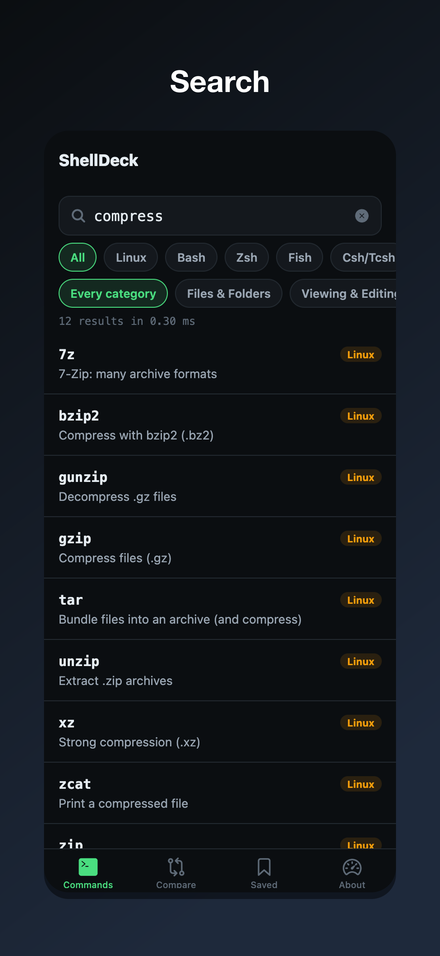
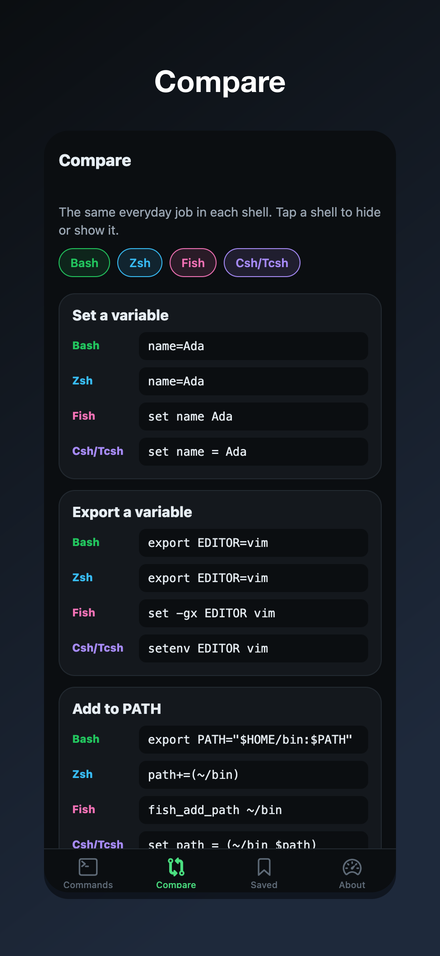

# ShipKit

**Ship Expo apps to the stores without the busywork.**

A CLI that does the boring parts of a release: it checks your app config for things Apple and Google reject, writes release notes from your git history, turns raw screenshots into store-ready images, and shows the EAS build status of every app you own on one screen.

[](https://github.com/tejHacks/shipkit/actions/workflows/ci.yml)


<p align="center">
  
  
  <br><sub>Made by <code>shipkit frame</code> from plain simulator screenshots</sub>
</p>

## Commands

### `shipkit check` — store-readiness audit

```
ShellDeck — store readiness

  ! Build numbers are not managed.
    Set cli.appVersionSource to "remote" and build.production.autoIncrement to true in eas.json.
  ! supportsTablet is on, so App Store Connect requires 13" iPad screenshots.
  ✓ Version 1.0.0
  ✓ iOS bundle com.olateju.shelldeck
  ✓ Android package com.olateju.shelldeck
  ✓ App icon 1024×1024, opaque
```

Checks the things that cost a review cycle:

- Bundle ID and package name are valid and not placeholders (hyphens break Android packages)
- Icon exists, is 1024×1024 and has no transparency
- Adaptive icon and splash screen are configured
- Build numbers will not collide (`appVersionSource` / `autoIncrement` in eas.json)
- Every installed permission package (camera, location, photos…) has a real iOS purpose string, not Expo's generic one (Guideline 5.1.1)
- Play-restricted Android permissions such as `READ_SMS` and `MANAGE_EXTERNAL_STORAGE`
- `supportsTablet` means iPad screenshots are required
- Version was bumped since the last git tag

It exits with code 1 when there are errors, so it can gate CI.

### `shipkit notes` — release notes from git

Reads commits since the last tag and sorts them into **New / Improved / Fixed**, leaving tooling work (CI, deps, refactors) under "Under the hood". Understands Conventional Commits and plain English subjects.

```bash
shipkit notes                  # Play, App Store and CHANGELOG versions
shipkit notes --format play    # ≤ 500 characters, cut at whole bullets
shipkit notes --from v1.2.0 --format md --out CHANGELOG-1.3.md
```

### `shipkit frame` — store screenshots

```bash
shipkit frame docs/screenshots --preset ios-6.9 --bg "#0B0E11,#1E293B"
```

Presets: `ios-6.9` (1320×2868), `ios-6.5` (1284×2778), `ipad-13` (2064×2752), `android` (1080×1920). Captions come from a `captions.json` next to the screenshots (`{ "02-search.png": "Find any command in milliseconds" }`) or from the file name. Output is opaque PNG, as both stores require.

### `shipkit builds` — EAS dashboard

```bash
shipkit builds                              # this app
shipkit builds ~/Developer/apps --all       # every app in the folder
```

```
App            Platform  Status      Version    Profile     When      Avg build  Success
cribdoc        android   ✓ finished  1.0.0 (1)  preview     5d ago    12 min     3/3
hagah          android   ✓ finished  1.0.5 (4)  production  101d ago  14 min     10/10
kairos         android   ✓ finished  1.0.0 (7)  production  126d ago  17 min     5/10

28/36 recent builds succeeded (78%) across 14 app(s).
```

Uses `eas build:list --json`, so it works with whatever account the EAS CLI is logged into. Failed builds are listed with a link to their logs. Set `SHIPKIT_EAS=eas` to use a global EAS CLI instead of `npx eas-cli@latest`.

## Install

```bash
git clone https://github.com/tejHacks/shipkit && cd shipkit
npm install && npm run build && npm link
shipkit --help
```

## Development

```bash
npm run dev -- check ../my-app   # run from source (Node strips the types)
npm test                         # node:test, no framework
npm run typecheck
```

Design notes:

- **Pure core, thin IO.** `runChecks`, `classify`/`buildNotes` and `summarise` take plain data and return plain data, so every rule is unit-tested without touching disk, git or the network.
- **No CLI framework.** Argument parsing is `node:util` `parseArgs`; the only runtime dependency is `sharp`.
- **TypeScript without a build step in development.** Node runs `src/*.ts` directly; `tsc` with `rewriteRelativeImportExtensions` produces `dist/` for publishing.

## Roadmap

- [ ] `shipkit submit` — check, notes and `eas submit` in one step
- [ ] Device frames and localized captions for `frame`
- [ ] Crash-free rate per app (Sentry / Firebase Crashlytics) in `builds`
- [ ] Hosted dashboard with build alerts for teams

## License

MIT
